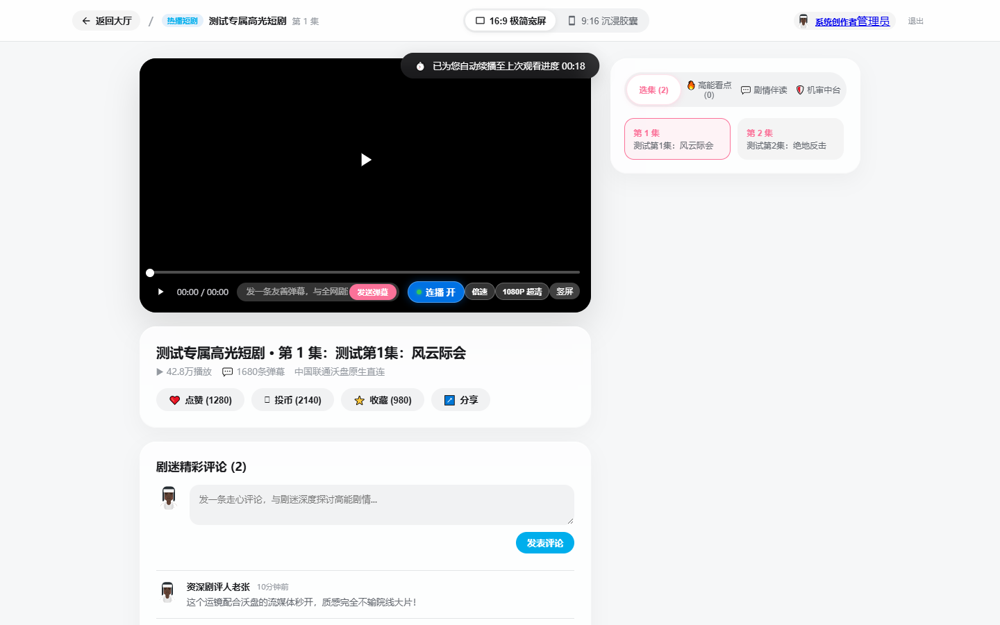
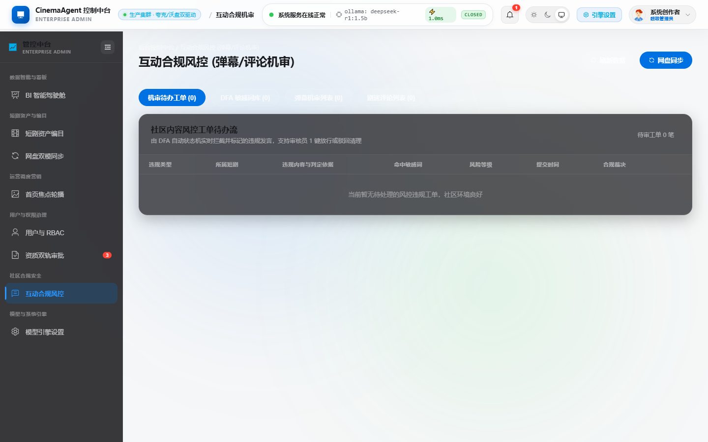
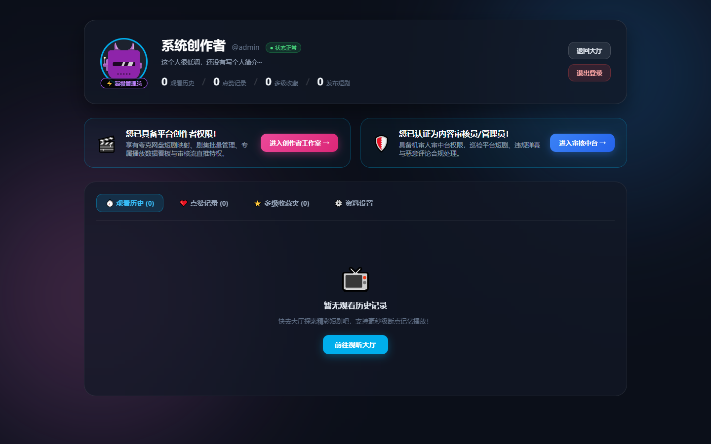
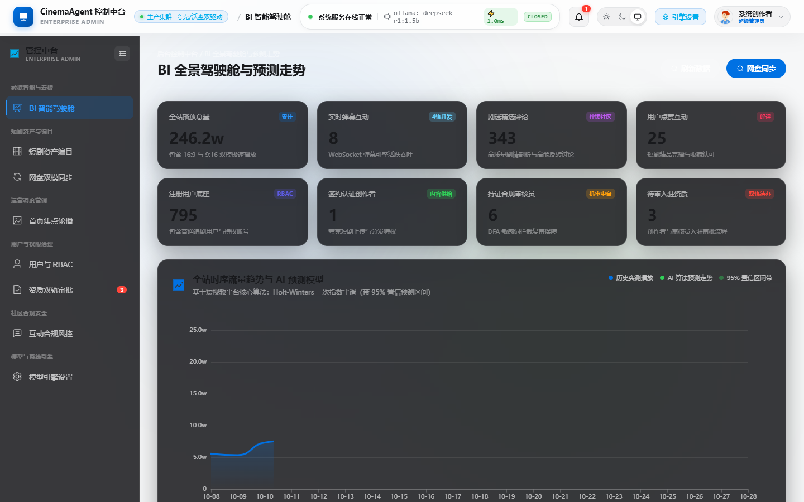

# CinemaAgent - 工业级多媒体短剧视听与多智能体协同研创中台

CinemaAgent 是一套专为竖屏短剧、微短剧创作者、影视制作机构及平台运营方量身打造的工业级视听与 AI 多智能体协同生产中台。
项目向下通过中国联通云盘（沃盘）海量对象存储驱动（基于 OpenList 原生网关）突破本地磁盘瓶颈，实现标准 HTTP 206 流媒体切片代理与秒级 Seek 断点续播；向上构建了由 10 大垂直领域专家组成的自主协同智能体蜂群，深度融合基于 LangGraph 原语的 Plan & Execute 动态待办清单（TodoList）工作流、共享黑板决策架构（Blackboard Memory Hub）、多模态时间轴 Advanced RAG 视听知识库以及 RAGAS 五维量化自动化评测中台。

---

## 核心系统模块与高清界面预览

### 1. 暗黑影院 9:16 移动端拟态播放器与多模态时间轴 RAG 伴读

- **流媒体切片分发与秒级 Seek**：基于 OpenList 对象存储驱动，实现标准 HTTP Range 206 状态码分片点播，支撑百兆级短剧视频任意拖拽与秒级加载。
- **时间轴视频伴读 Agent**：依托多模态剧情切片模型，精准识别视频各时间戳镜头。问答回复自动生成高亮时间戳胶囊按钮，点击直接毫秒级定位跳转播放。
- **动态交互微动画**：采用现代克制暗黑拟态风格，支持平滑换集、四轨道防碰撞弹幕流、点赞粒子动效与记忆续播。

---

### 2. 企业级管控中台与 BI 全景数据大屏

- **运营大盘与投流漏斗**：实时监测短剧总播放量、完播率转化漏斗、用户停留时长分布与金币打赏收益。
- **智能体调用监控拓扑**：动态捕获 10 大垂直专家的调用频次、端到端响应耗时、Token 消耗分布与双网关健康状态。
- **全链路操作审计追踪**：内置审计日志体系，对数据变动、敏感权限访问执行可追溯记录。

---

### 3. 内容安全风控台与 DFA 毫秒级违禁词过滤

- **DFA 确定有限状态自动机**：弹幕与评论采用 DFA 算法毫秒级扫描敏感词库，精准阻断违禁违规内容上屏。
- **人机协同复核链路**：被拦截的争议内容自动进入风控待审池，结合大模型合规专家（4号智能体）给出风险研判标签，支持审核员一键放行或永久封禁。

---

### 4. 沉浸式剧场大厅短剧海报流与智能推荐

- **多维度短剧编目分类**：涵盖都市战神、豪门逆袭、科幻悬疑等垂直标签，支持关键字即时检索与模糊过滤。
- **现代玻璃拟态海报轮播**：支持高能切片预览、评分看板与一键追剧收藏。

---

### 5. 用户中心 Bento 风格个人空间与数字资产看板

- **Bento 栅格化资产布局**：集成金币钱包、等级徽章、观影历史时光机、收藏夹与个人创作者认证。
- **金币打赏与激励闭环**：支持弹幕高能打赏、每日签到金币累加与创作者提现分润流转。

---

### 6. 短剧资产编目与全流程上架治理

- **云盘目录映射与自动化挂载**：一键同步中国联通沃盘云端短剧切片目录，自动生成多集选集序列。
- **FFmpeg 异步元数据解析**：自动探测分辨率、码率、帧率，智能抽取前 3 秒高分辨率精彩帧作为短剧主封面。

---

### 7. Apple HIG 现代克制设计规范与主题自适应

- **去 AI 廉价感质感打造**：严控留白、毛玻璃层级模糊（Backdrop Blur）、细腻微边框（1px Hairline）与自然弹性过渡。
- **全域 CSS 变量体系**：严格杜绝颜色绝对硬编码，自适应暗黑模式与浅色模式。

---

## 核心技术架构特性

### 1. 工业级多智能体协同蜂群 (Agent Fleet & Mesh)
- **10大垂直领域专家座席**：涵盖 1号编剧、2号开发、3号BI数据分析师、4号合规风控官、5号制片统筹、6号剪辑多模态、7号影视全链管家、8号分镜导演、9号常务主控议长以及 10号 Coze 外部生态网关。
- **Plan & Execute 动态待办清单 (TodoList)**：9号主控大脑实时锁定研讨标的，动态将复合业务指令分解为任意级联的原子任务清单（`- [ ] Step N`）。前端圆桌看板实时推进 `pending` -> `in_progress` -> `completed` 状态流转，回显单步执行耗时。
- **杜绝越权代答与离题保障**：9号总控在规划阶段仅输出任务清单，严禁假冒专家提前作答；下发任务通过专用上下文包装器绑定标的上下文，彻底解决垂直专家脱幅与盲查无关数据库问题。

### 2. 共享黑板架构与共识决议中枢 (Blackboard Memory Hub)
- **非对称多方协同总线**：各垂直专家不直接采用点对点网状通信，统一经由异步互斥锁（`asyncio.Lock`）安全读写会话黑板内存。
- **冲突仲裁与共识收敛**：内置指标对立检测机制（如制片成本预算与分镜高规格特效之间的诉求对立），由 9号主控议长基于投放阶段 ROI 权重进行仲裁裁决，最终输出结构化的【圆桌研讨决议与多方成果总结】白皮书。

### 3. 多模态视频时间轴 Advanced RAG & 毫秒级播放器跳转
- **多模态时空切片构建**：利用 FFmpeg 抽取关键帧与音频轨道，融合 OCR 文本识别与 Whisper 语音转录，构建带精准起止时间戳（`start_sec` ~ `end_sec`）的知识切片。
- **三路混合召回与 RRF 融合**：并发调起 ChromaDB 向量密集检索、结巴分词 BM25 稀疏检索与时间跨度关联，利用倒数排名融合（RRF）算法公平排队，再经由 Cross-Encoder 深度重排器（Reranker）打分提取黄金上下文。
- **Self-RAG 四重抗幻觉自省**：回答生成严格执行 `should_retrieve`、`is_relevant`、`is_supported`（100% 原文支撑断言）与 `is_useful` 四重质检卡，彻底杜绝大模型凭空捏造剧情。
- **播放器联动跳转**：问答返回结果中关键剧情节点自动转换为时间戳胶囊按钮，点击直接毫秒级定位跳转播放。

### 4. RAGAS 五维量化评测体系与自动化故障诊断决策树
- **量化评测黄金基准集**：构建覆盖主线剧情、细节推断等真实场景的测试集，量化测评真实忠实度（Faithfulness）、回答相关度（Answer Relevance）、上下文精度（Context Precision）、上下文召回率（Context Recall）与调和平均值（Harmonic Score）。
- **工程并发加速与决策树处方**：聚合打分与多线程并发优化，评测耗时大幅缩减；系统根据指标雷达图自动出具工程优化诊断处方。

---

## 架构流程图 (Draw.io 26.0.15 原生兼容)

项目在 `docs/cinema_agent_architecture.drawio` 中提供了采用 Draw.io 标准 XML 格式构建的工程级架构图，支持在 **Draw.io 26.0.15** 客户端中原生打开与多页签交互：

- **标签页 1**：智能体 Workflow 待办流转框架 (Plan & Execute 动态待办管线)
- **标签页 2**：多智能体专家矩阵与蜂群协同框架 (Multi-Agent Fleet Mesh)
- **标签页 3**：共享黑板架构与共识决议框架 (Blackboard Architecture & Consensus)
- **标签页 4**：智能意图识别与自适应路由分发框架 (Intent Routing & Gateway Dispatcher)

打开方式：启动 Draw.io 26.0.15 软件，点击【文件】->【打开】，选择 `docs/cinema_agent_architecture.drawio` 即可查看与编辑全部矢量节点。

完整答辩逐字稿请参阅：`docs/PROJECT_PRESENTATION_SCRIPT.md`。

---

## 技术栈全景

- **业务代理与网关层**：Python 3.12 + FastAPI + Uvicorn + WebSockets + Httpx
- **智能体编排与状态图**：LangGraph 原语 + 自研 Agent Mesh 调度器
- **持久化与共享内存**：MySQL 8.0 + SQLAlchemy 2.0 ORM + BlackboardMemoryHub
- **知识检索与向量库**：Neo4j 知识图谱 + ChromaDB + BM25 (Jieba) + Cross-Encoder Reranker
- **大模型双网关调度**：云端高性能模型 (MiniMax / DeepSeek) + 本地私有化 Ollama (Qwen2.5:7b)
- **云盘中继与媒体处理**：OpenList 网关 (端口 5244) + FFmpeg (音视频转码与帧提取)
- **前端交互与视窗**：Vue 3 + TypeScript + Vite + Pinia + Element Plus
- **安全风控与算法**：DFA (确定有限状态自动机) + RBAC 权限控制体系

---

## 快速启动指南

### 方式一：Windows 双击一键启动

双击根目录下的 **`start_all_services.bat`**。
脚本将自动启动 OpenList 云盘存储中继网关与 FastAPI 业务中台，并在启动完成后自动唤起浏览器打开：
`http://127.0.0.1:8000/`

如需停止全套服务，双击运行 **`stop_all_services.bat`**。

---

### 方式二：手动分步启动

#### 步骤 1：启动中国联通云盘网关 (OpenList)
在根目录双击 **`start_openlist.bat`**（或进入 OpenList 目录执行）：
```cmd
openlist.exe server
```
- OpenList 管理后台地址：`http://127.0.0.1:5244`

#### 步骤 2：启动 FastAPI 业务后端
在根目录打开终端（PowerShell 或 CMD）：
```cmd
cd backend
python main.py
```
- 服务监听地址：`http://127.0.0.1:8000`
- API 交互式文档 (Swagger UI)：`http://127.0.0.1:8000/docs`

#### 步骤 3：启动前端开发调试服务器（可选）
```cmd
cd frontend
npm run dev
```
- 前端开发调试地址：`http://127.0.0.1:5173`

---

## 自动化测试与质量验证

项目全流程遵循严格的测试驱动规范，所有核心业务均包含自动化端到端测试套件：

```bash
# 1. 沃盘流式点播与 HTTP 206 校验
python backend/tests/e2e/test_step1_stream.py

# 2. 切片上传与 FFmpeg 封面转码校验
python backend/tests/e2e/test_step2_upload.py

# 3. 9:16 移动播放器、选集与互动测试
python backend/tests/e2e/test_step3_player.py

# 4. WebSocket 弹幕广播与 DFA 敏感词机审阻断测试
python backend/tests/e2e/test_step4_danmaku_review.py

# 5. 视频知识库 RAG 伴读与时间戳跳转测试
python backend/tests/e2e/test_step5_agent.py

# 6. 前端静态类型完整性校验
cd frontend && npx vue-tsc --noEmit
```
所有测试均已通过，可随时独立回归运行。
