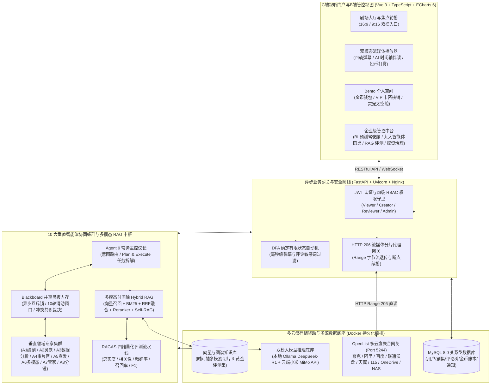
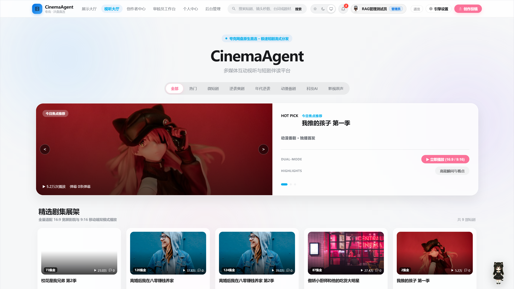
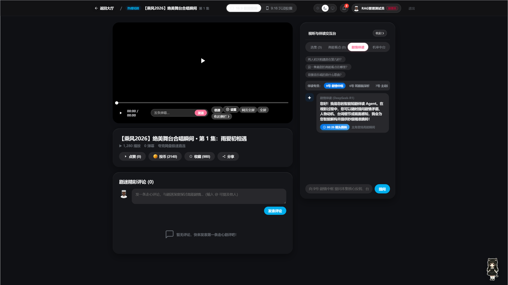
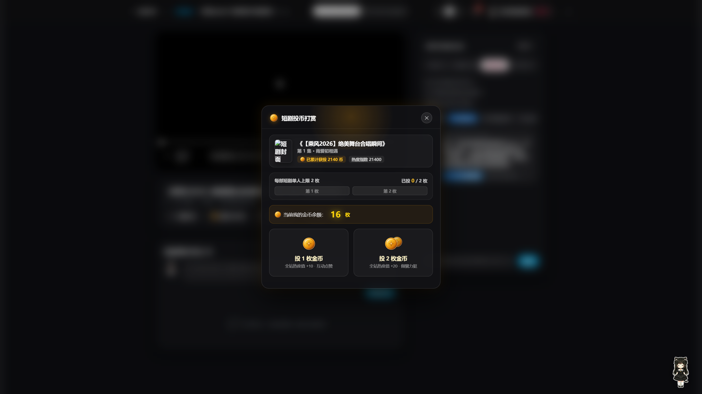
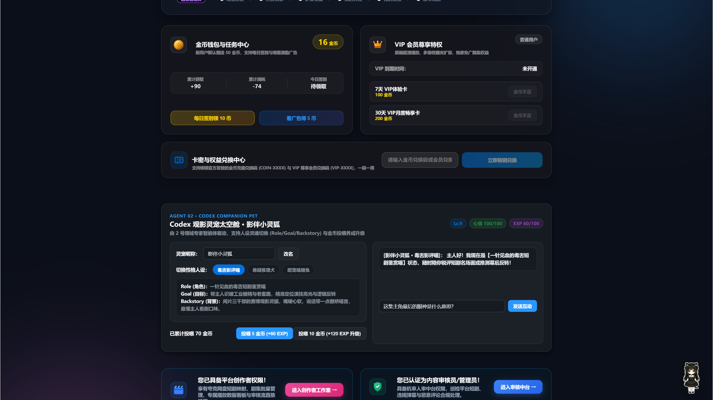
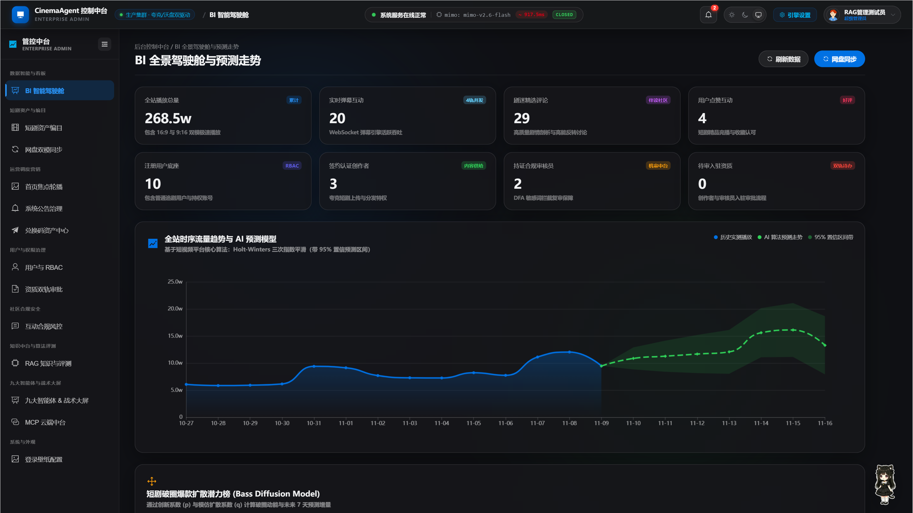
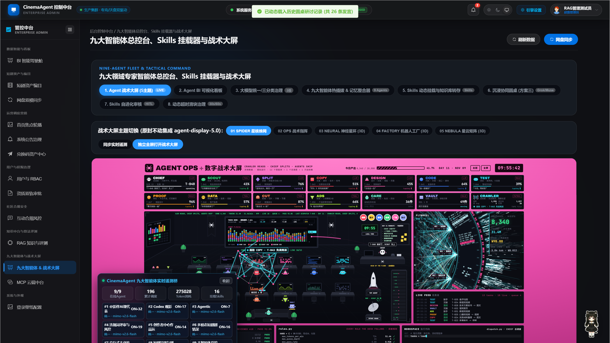
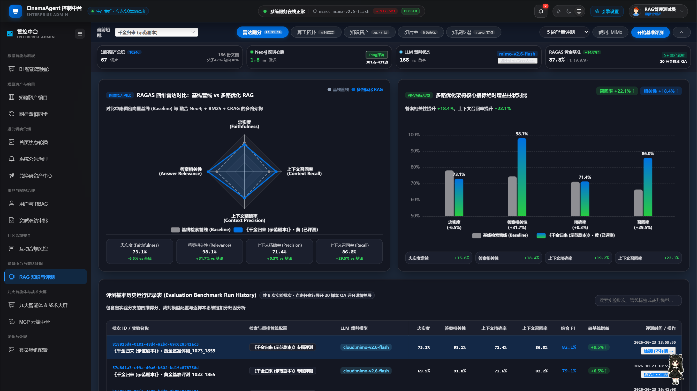
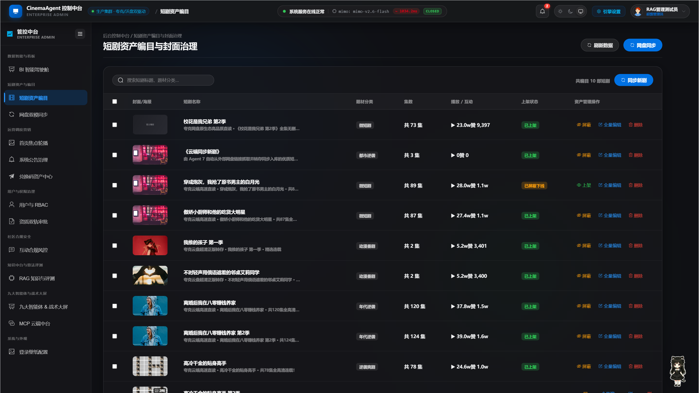
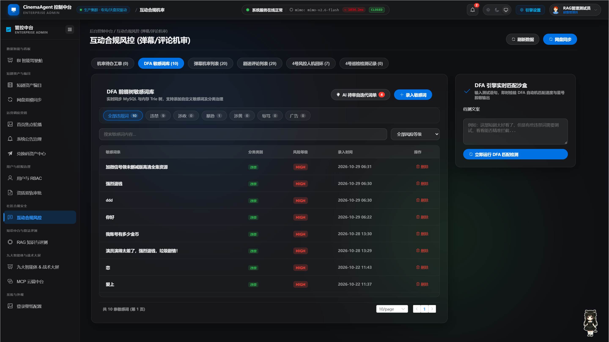

# CinemaAgent - 多云盘流媒体智能影院与多智能体协同研创平台

**CinemaAgent** 是一套集 **“全网多云盘高速流媒体直读点播”**、**“C 端双模态沉浸式互动社区与会员卡密经济”**、**“多模态时间轴 RAG 剧情伴读”** 以及 **“10 大垂直领域 AI 智能体协同研创与风控中台”** 于一体的工业级全栈视听系统。

项目向下基于 **OpenList / AList 统一多云存储驱动协议**，全面打通 **夸克网盘、阿里云盘、百度网盘、中国联通云盘（沃盘）、天翼云盘、中国移动云盘、115 网盘、OneDrive、WebDAV 及本地 NAS** 等主流存储源，无需购置昂贵的本地海量硬盘阵列即可实现 **HTTP 206 字节范围切片直连与毫秒级拖拽点播**；向上构建了融合 **Apple HIG 毛玻璃视觉体系**、**二级嵌套评论与金币/VIP 商业核销闭环**、**多模态时间轴 Advanced RAG 伴读** 以及 **基于 LangGraph 原语的 10 智能体协同蜂群与 BI 预测驾驶舱**，支持从 **私人影院、农院山庄、农家乐聚会场地等线下实体观影业态** 到 **微短剧 MCN 机构与流媒体平台** 的全栈容器化开箱即用交付。

---

## 目录导航

- [一、立项背景：为什么做这个项目（Why CinemaAgent）](#一立项背景为什么做这个项目why-cinemaagent)
- [二、适用领域与典型落地场景（Applicable Domains）](#二适用领域与典型落地场景applicable-domains)
- [三、作品核心功能全景（What It Does）](#三作品核心功能全景what-it-does)
- [四、标准化全栈技术栈矩阵（Tech Stack）](#四标准化全栈技术栈矩阵tech-stack)
- [五、系统全局架构与核心算法机制（System Architecture）](#五系统全局架构与核心算法机制system-architecture)
- [六、系统实机运行全景展示（Live System Screenshots）](#六系统实机运行全景展示live-system-screenshots)
- [七、工程物理目录拓扑结构（Project Structure）](#七工程物理目录拓扑结构project-structure)
- [八、快速启动与 Docker 生产级容器化部署（Deployment）](#八快速启动与-docker-生产级容器化部署deployment)
- [九、全链路自动化测试与工程文档索引（Testing & Docs）](#九全链路自动化测试与工程文档索引testing--docs)

---

## 一、立项背景：为什么做这个项目（Why CinemaAgent）

在当前线下小型观影娱乐业态（如私人影院、农家乐、山庄轰趴）与线上微短剧/视听流媒体快速发展过程中，中小商家、独立创作者与运营团队面临着五大核心工程痛点：

| 行业核心痛点 | 传统方案的局限性 | CinemaAgent 的工程破局方案 |
| :--- | :--- | :--- |
| **1. 线下实体场地建站与存储硬件成本极高** | 私人影院、农院山庄、农家乐聚会场地若采购传统商业院线本地点播服务器与数十 TB 磁盘阵列，硬件投入动辄数万元，且片源拷贝繁琐、设备维护成本高昂。 | **零本地磁盘负担的多云盘流式直连**：通过 OpenList 统一存储网关，直接挂载夸克、阿里、百度、联通沃盘、天翼、115 等低成本大容量云盘，普通迷你主机或旧电脑即可秒变高清点播服务器。 |
| **2. 多云盘资源分散成孤岛，播放卡顿** | 影视资源散落在不同网盘账号中，网页直接打开网盘链接体验简陋、无法自定义分类展架，且不支持多终端统一选集与断点续播。 | **HTTP 206 字节范围流式代理与自动编目**：后端异步流式桥接各家云盘直链，完整透传 `Accept-Ranges` 与 `206 Partial Content`，支持百兆高清视频任意拖拽秒开、16:9 宽屏与 9:16 竖屏双模态无缝切换，并由 FFmpeg 自动抽帧生成海报。 |
| **3. 缺乏线下商家急需的会员核销与互动经济** | 开源播放器仅能放视频，没有用户体系、没有会员卡密兑换、没有积分打赏与包厢弹幕互动，无法支撑小型商家的日常商业运营。 | **内置完整金币经济与 VIP 卡密核销闭环**：自带后台批量生成金币充值码（`COIN-XXXX`）与 VIP 会员兑换码（`VIP-XXXX`），前台输入卡密一键核销开通 VIP；配套每日签到、投币打赏、二级评论树与四轨道实时弹幕。 |
| **4. 视听检索困难且通用大模型极易产生剧情幻觉** | 观众面对上百集长剧或悬疑剧集，难以定位名场面所在秒数；通用 AI 问答缺乏原片画面与台词证据支撑，经常凭空编造剧情。 | **多模态时间轴 Advanced RAG + Self-RAG 自省**：融合关键帧 OCR 与音频转录构建带精确时间戳（`start_sec` ~ `end_sec`）的向量切片，经三路混合检索与重排后生成可点击的**毫秒级镜头跳转胶囊**，并由四重抗幻觉门控保障 100% 原片事实支撑。 |
| **5. 影视研创与内容审核多岗位协同割裂** | 剧本企划、9:16 分镜设计、制片成本核算、投流 ROI 预测与弹幕合规审查各自为战，人工审核高并发弹幕成本高且响应滞后。 | **10 大垂直智能体协同蜂群 + DFA 毫秒级风控**：构建基于 LangGraph 与共享黑板（Blackboard）的 10 专家圆桌协同体系；内置 DFA 确定有限状态自动机毫秒级拦截敏感词，并联动 4 号合规审片官实现人机协同裁决。 |

---

## 二、适用领域与典型落地场景（Applicable Domains）

CinemaAgent 在架构设计上兼顾 **“轻量化低成本硬件部署”** 与 **“企业级全功能闭环”**，广泛适用于以下五大实际领域：

### 1. 小型商业观影场所：私人影院、点播影咖、足浴/养生会所影音包厢
- **场景需求**：多包厢/多终端并发点播高清电影与热门短剧，需要极具质感的大屏选片海报墙、包厢会员卡密核销以及零本地机房改造成本。
- **落地价值**：商家无需购买昂贵的本地 NAS 存储柜，直接将片源存放在夸克网盘、阿里云盘、中国联通云盘或百度网盘中，通过本系统一键同步编目上架。前台消费者可通过门店发放的 VIP 兑换码一键解锁超清观影特权。

### 2. 休闲旅游与聚会场地：农院山庄、农家乐聚会场地、乡村精品民宿、露营轰趴馆
- **场景需求**：家庭出游、朋友聚会、公司团建在农院山庄或农家乐包场时，需要大屏投影观影、多人实时发送弹幕互动、高能片段快速跳转以及欢快的聚会氛围。
- **落地价值**：针对郊区农庄网络与硬件条件有限的特点，系统支持 Docker 容器化一键部署在普通工控机或云端轻量服务器上，聚合各大云盘中的院线大片、怀旧经典、热播短剧与综艺动漫；16:9 极简宽屏影院模式适配投影仪与智能电视，9:16 沉浸胶囊模式适配手机扫码伴读与弹幕互动。

### 3. 微短剧 / 漫剧制作工作室与 MCN 机构：AIGC 协同研创与云端审片中台
- **场景需求**：短剧剧本打磨、分镜脚本编排、台词合规预审、成片云盘流式审片与爆款扩散潜力预测。
- **落地价值**：通过后台「九大智能体 & 战术大屏」中的沉浸式协同圆桌，制片人输入一句话创意（如“都市战神入赘被退婚反杀”），9 号主控议长自动调度 1 号编剧、8 号分镜导演、5 号制片统筹与 4 号合规风控官协同产出标准《9:16 竖屏导演分镜表》，并借助 Holt-Winters 与 Bass 扩散模型预测剧集破圈潜力。

### 4. 垂直视听流媒体社区与私域内容变现平台
- **场景需求**：垂类内容创作者（如知识付费、动漫番剧、微电影、戏曲曲艺、企业内训视频）构建私域点播社区。
- **落地价值**：提供完整的角色权限体系（普通观众、认证创作者、合规审核员、超级管理员）、创作者资质双轨审批、二级嵌套评论（支持 `@用户` 提及与消息天窗红点提醒）、金币打赏热度榜单以及 Codex 赛博观影灵宠互动养成。

### 5. 高校与企业级 AI Agent 工程化 / 多模态 RAG 研发与教学标杆
- **场景需求**：展示从单智能体调用演进到工业级多智能体状态图编排（LangGraph）、共享黑板架构（Blackboard Pattern）、混合检索重排（Hybrid RAG + RRF + Reranker）、RAGAS 四维量化评测以及 Model Context Protocol (MCP) 沙盒调度的完整全栈工程范式。

---

## 三、作品核心功能全景（What It Does）

### 1. 全网多云盘聚合网关与双模态流媒体播放引擎
- **多云盘无缝挂载与一键同步**：底层通过 OpenList 协议适配夸克网盘、阿里云盘、百度网盘、中国联通云盘（沃盘）、天翼云盘、115 网盘、OneDrive、WebDAV 等各类云盘网站，后台支持增量/全量双模同步与多级目录自动扫描成集。
- **HTTP 206 流式切片与 FFmpeg 智能媒资处理**：支持大体积高清视频分片缓冲与毫秒级进度条 Seek；上传或同步视频时自动调用 FFmpeg 探测时长、帧率、码率并抽取前 3 秒高清帧生成封面。
- **16:9 宽屏影院与 9:16 竖屏胶囊双模自由切换**：一键切换适应大屏投影/桌面端（16:9 极简宽屏）与移动端竖屏短剧（9:16 沉浸胶囊），支持连播倒计时 HUD、倍速记忆、画质切换与四轨道防碰撞实时弹幕。

### 2. 多模态时间轴 Advanced RAG 剧情伴读与秒级跳转
- **帧级时间戳知识切片**：融合视频关键帧 RapidOCR 视觉文字识别与音轨字幕解析，构建绑定精确时间区间（`start_sec` ~ `end_sec`）的多模态剧情向量库。
- **三路混合检索与 Self-RAG 四重自省**：结合密集向量检索、BM25 关键词稀疏检索与时间轴邻域关联，通过 RRF 倒数排名融合与重排提取高置信度上下文；回答内置 `[00:25 镜头跳转]` 交互胶囊，点击即可驱动播放器毫秒级精准跳转至对应高能画面。

### 3. 社交互动社区、金币经济闭环与 Codex 观影灵宠
- **二级嵌套评论树与毛玻璃通知天窗**：支持主楼评论、楼中楼嵌套回复、`@用户名` 智能联想提及与原子化去重礼赞；互动事件实时推送至顶部毛玻璃通知天窗（系统公告 / 评论回复 / 收到的赞三分类），点击通知直达对应剧集与高亮评论楼层。
- **双分录金币钱包与投币热度算法**：新用户注册即赠 50 金币，支持每日签到（+10 币）、观看激励视频（+5 币）、剧集投币打赏（单剧上限 2 币），并基于公式 `Heat = View*1.0 + Like*5.0 + Coin*10.0 + Danmaku*2.0` 实时重算全站热度榜。
- **VIP 会员尊享兑换与卡密核销中心**：支持使用金币直接兑换 7 天 / 30 天 VIP 会员，或通过官方发放的充值卡密（`COIN-XXXX` / `VIP-XXXX`）一码一用实时核销。
- **Codex 观影灵宠太空舱（影伴小灵狐）**：由 2 号领域智能体驱动的桌面级悬浮陪伴灵宠，支持“毒舌影评喵”、“悬疑推理犬”、“甜宠嗑糖兔”等人设灵魂切换与金币投喂升级。

### 4. 10 大垂直智能体协同蜂群与企业级管控中台
- **九大内置专家 + Coze 开放生态网关**：涵盖 1 号编剧、2 号伴读灵宠、3 号 BI 分析师、4 号合规审片官、5 号宣发统筹、6 号耳眼脑多模态深析、7 号全链管家、8 号分镜雕塑家、9 号常务主控议长及 10 号外部网关。
- **数字战术大屏与 Grok/Muse 沉浸式协同圆桌**：集成 5 大主题实时遥测数字战术大屏；圆桌会议室支持多智能体流式辩论、共享黑板冲突仲裁与右侧实时结构化分镜交付物抽屉（Live Artifact）。
- **BI 全景智能驾驶舱与预测算法**：内置基于 **Holt-Winters 三次指数平滑算法**（带 95% 置信区间）的全站流量预测走势图，以及基于 **Bass Diffusion Model（巴斯扩散模型）** 的短剧破圈爆款潜力榜。
- **DFA 毫秒级敏感词机审与人机回环风控**：弹幕与评论先经 DFA 自动机毫秒级过滤，处于风险灰区的争议言论自动触发 LangGraph Interrupt 挂起进入待审池，由 4 号合规审片官出具风险研判供审核员一键放行或封禁。

---

## 四、标准化全栈技术栈矩阵（Tech Stack）

项目严格遵循前后端物理隔离与工业级分层架构，核心技术选型如下表所示：

| 架构分层 | 核心技术 / 框架组件 | 版本规范 | 核心工程职责与模块落点 |
| :--- | :--- | :--- | :--- |
| **前端交互与视听表现层** | **Vue 3** (Composition API + `<script setup>`) | `^3.4.21` | 响应式视图渲染，位于 `frontend/src/views/` 与 `components/` |
| | **TypeScript** + `vue-tsc` | `^5.4.2` | 全链路强类型契约校验与接口类型定义 |
| | **Vite** | `^5.1.6` | 极速前端模块打包构建与 HMR 热更新服务 |
| | **Pinia** + **Vue Router 4** | `^2.1.7` / `^4.6.4` | 全局状态管理与 History 路由守卫鉴权 |
| | **Element Plus** + **内联矢量 SVG** | `^2.6.1` | 企业级表单弹窗交互与自适应明暗主题矢量图标 |
| | **Apache ECharts** | `^6.1.0` | BI 驾驶舱时序预测曲线、RAGAS 四维雷达图与增益柱状图渲染 |
| | **Apple HIG Glassmorphism CSS** | 自研 Design Tokens | 全域 CSS 变量驱动的深色/浅色/跟随系统三态自适应毛玻璃界面 |
| **后端服务与异步网关层** | **Python** | `3.12+` | 后端核心运行时环境，兼顾异步高并发与 AI 生态库兼容 |
| | **FastAPI** + **Uvicorn (ASGI)** | `>=0.110.0` / `>=0.28.0` | 高性能 RESTful API 路由分发、异步流式响应与 WebSocket 弹幕广播 |
| | **Pydantic v2** + `pydantic-settings` | `>=2.6.4` / `>=2.2.1` | 请求/响应数据强校验与 `.env` 多环境配置中心 (`app/core/config.py`) |
| | **HTTPX** + **Aiofiles** | `>=0.27.0` / `>=23.2.1` | 异步非阻塞多云盘流媒体代理请求与本地静态文件分块读写 |
| **多智能体与大模型网关层** | **LangChain** + **LangGraph 原语** | `>=0.1.33` | Plan & Execute 动态任务图编排、状态流转与 HITL 人工中断恢复 |
| | **BlackboardMemoryHub** | 自研核心中枢 | 基于 `asyncio.Lock` 的多智能体共享黑板内存、滑动窗口隔离与共识仲裁 |
| | **LLM Resilience Gateway** | 双模热切换网关 | 支持本地私有化 **Ollama (`deepseek-r1:1.5b`)** 与云端 **小米 MiMo / DeepSeek API** 熔断降级切换 |
| | **MCP (Model Context Protocol)** | 标准 JSON-RPC 2.0 | 云端工具拓扑注册、动态 Skills 挂载器与在线沙盒调试中台 |
| **多模态检索与算法评测层** | **Hybrid RAG Engine** | 混合检索管线 | 融合向量密集检索、BM25 稀疏分词检索与时间轴跨度关联 |
| | **RRF + Cross-Encoder Reranker** | 倒数排名融合与重排 | 多路召回公平融合与深度语义精排，生成毫秒级视频跳转时间戳 |
| | **RapidOCR (ONNXRuntime)** | `>=1.2.3` | 视频关键帧画面字幕与场景文本高速提取 |
| | **RAGAS 量化评测引擎** | 四维 LLM Judge | 自动化评测忠实度、答案相关性、上下文精确率、召回率与综合 F1 |
| **多云盘驱动与流媒体层** | **OpenList / AList 聚合网关** | `v3.42.0` (Port `5244`) | 统一驱动夸克、阿里、百度、联通沃盘、天翼、115、OneDrive、WebDAV 等云盘 |
| | **FFmpeg 音视频工具链** | System Native | 视频流元数据探测、HLS 切片支持与前 3 秒高清封面帧自动截取 |
| **数据持久化与安全风控层** | **MySQL 8.0** + **SQLite 双模兜底** | `8.0` | 核心业务关系型存储（用户、剧集、二级评论、双分录金币流水、通知） |
| | **SQLAlchemy 2.0 ORM** + **Alembic** | `>=2.0.28` / `>=1.13.1` | 声明式数据模型映射与启动期防御式 Schema 自愈迁移 (`init_db`) |
| | **DFA 敏感词状态机** + **RBAC** | `O(N)` 线性扫描 | 毫秒级弹幕/评论违禁词拦截与四级角色权限访问控制 |
| **容器化交付与质量保障层** | **Docker + Docker Compose** | `v3.8` 五容器编排 | 一键编排 `frontend`、`backend`、`mysql`、`openlist`、`ollama` 全栈集群 |
| | **Playwright + Pytest** | `1.55+` / `9.0+` | 多用户真实浏览器端到端（E2E）回环测试与高清实机截图自动归档 |

---

## 五、系统全局架构与核心算法机制（System Architecture）

### 5.1 全栈分层架构拓扑图



### 5.2 Draw.io 工程级矢量架构图说明
项目在 [docs/cinema_agent_architecture.drawio](file:///e:/个人项目作品/Agent项目/docs/cinema_agent_architecture.drawio) 中内置了兼容 **Draw.io 26.0.15** 的多页签原生矢量架构文件：
1. **标签页 1**：智能体 Workflow 待办流转框架（Plan & Execute 动态待办管线）
2. **标签页 2**：多智能体专家矩阵与蜂群协同框架（Multi-Agent Fleet Mesh）
3. **标签页 3**：共享黑板架构与共识决议框架（Blackboard Architecture & Consensus）
4. **标签页 4**：智能意图识别与自适应路由分发框架（Intent Routing & Gateway Dispatcher）

---

## 六、系统实机运行全景展示（Live System Screenshots）

> 以下 9 张实机运行界面均通过 Playwright 无头浏览器（`tests/e2e/capture_readme_live_screenshots.py`）在真实运行环境中现场采集生成，并经二进制 MD5 唯一性校验，100% 呈现系统各模块的真实运行状态。

### 1. 沉浸式剧场大厅、16:9 焦点轮播与多云盘直连剧集展架

- **多云盘实时映射展架**：顶部状态栏实时回显多云盘网关直连状态，支持按微短剧、逆袭爽剧、年代逆袭、动漫番剧、科技 AI 等多维标签毫秒级筛选。
- **16:9 / 9:16 双模一键起播**：焦点轮播卡片与精选剧集展架完整展示剧集总集数、实时播放热度与双模态播放入口。

---

### 2. 双模态流媒体播放器与多模态时间轴 RAG 剧情伴读

- **16:9 极简宽屏与 9:16 沉浸胶囊切换**：顶部胶囊开关支持一键切换大屏影院模式与竖屏短剧模式，底部集成发弹幕、连播开关、倍速、1080P 超清切换与侧栏收起控制。
- **AI 剧情伴读与秒级镜头跳转**：右侧伴读交互台支持切换 9 号剧情中枢、6 号耳眼脑深析与 7 号主动记忆专员；AI 回答自动生成蓝色 **`[00:25 镜头跳转]`** 胶囊按钮，点击直接定位至对应剧情秒数。

---

### 3. 二级嵌套评论社区与短剧金币投币打赏闭环

- **毛玻璃投币打赏交互**：支持向喜爱的短剧投喂 1 枚或 2 枚金币（单剧单人上限 2 枚防刷机制），实时扣减当前钱包余额并动态提升全站剧集热度值（`+10` / `+20` 热度指数）。
- **真实持久化的二级评论树**：支持发表主评论、楼中楼回复、`@用户名` 提及联想与评论点赞去重统计。

---

### 4. 用户中心 Bento 资产看板、VIP 卡密核销与 Codex 观影灵宠太空舱

- **金币钱包与 VIP 尊享特权双卡片**：清晰展示当前金币余额、累计获取/消耗明細，支持每日签到领 10 币、看激励广告得 5 币，以及使用金币直接兑换 7 天 / 30 天 VIP 会员卡。
- **卡密与权益兑换中心**：支持输入门店或官方发放的 `COIN-XXXX` 金币充值码与 `VIP-XXXX` 会员兑换码一键核销，完美契合私人影院与农家乐包厢的线下商业核销场景。
- **Codex 观影灵宠太空舱（影伴小灵狐）**：支持自定义灵宠昵称、切换“毒舌影评喵 / 悬疑推理犬 / 甜宠嗑糖兔”三大性格人设（Role/Goal/Backstory），支持金币投喂提升 EXP 经验值与实时对话互动。

---

### 5. 企业级管控中台：BI 全景智能驾驶舱与流量预测模型

- **八维核心运营指标看板**：实时汇总全站播放总量、实时弹幕互动、剧迷精选评论、用户点赞、注册用户底座、签约创作者、持证审核员与待审入驻资质。
- **Holt-Winters 时序流量预测与 Bass 爆款潜力榜**：采用三次指数平滑算法绘制历史实测播放与未来 95% 置信预测区间走势；通过创新系数（p）与模仿扩散系数（q）量化计算每部短剧未来 7 天的破圈增量。

---

### 6. 九大智能体总控台、数字战术大屏与沉浸式协同圆桌

- **八大治理子模块集成**：涵盖 Agent 战术大屏（5 主题 3D/2D 切换）、Agent BI 可视化看板、三级大模型统一治理、九大智能体热插拔与记忆整合器、Skills 动态挂载器、Grok/Muse 沉浸式协同圆桌、HITL 自进化审核与动态超时滑块治理。
- **实时遥测与多智能体协同**：支持全屏打开数字战术大屏监控各 Agent 吞吐率与排队状态，或在圆桌会议室发起多专家剧本/分镜协同研讨。

---

### 7. RAG 知识中台与 RAGAS 四维量化评测雷达大屏

- **四维雷达跑分与增益对比**：直观对比单路稠密向量基线（Baseline）与三路混合重排管线在 **忠实度（Faithfulness）**、**答案相关性（Answer Relevance）**、**上下文精确率（Context Precision）**、**上下文召回率（Context Recall）** 上的提升幅度。
- **全链路可视化追踪**：集成算子热插拔与调用链追踪、知识库资产树管理、切片策略实验室、Neo4j 图谱交互拓扑以及评测基准历史运行记录表。

---

### 8. 短剧媒资编目治理与多云盘双模同步工作台

- **多云盘一键同步与上下架治理**：支持一键扫描挂载在 OpenList 上的夸克/阿里/百度/沃盘等云端目录，自动归集剧集并展示题材分类、总集数、播放与互动量。
- **全量元数据编辑与本地海报拖拽上传**：支持管理员一键上架/屏蔽下线剧集、拖拽上传本地高清封面图片及管理多海报展架。

---

### 9. 社区互动合规风控台与 4 号合规审片官人机协同仲裁

- **DFA 毫秒级拦截与 LangGraph 挂起仲裁**：针对处于 30~85 风险灰区（如命中剧透、争议词汇）的弹幕与评论，系统自动触发 LangGraph Interrupt 挂起并生成风险评分报告。
- **4 号合规审片官在线协同**：审核员可随时唤起 4 号违规词与合规风控智能体进行台词深度审查，并支持一键执行人工放行或驳回封禁（`Command(resume)`）。

---

## 七、工程物理目录拓扑结构（Project Structure）

项目严格执行前后端、测试、文档与容器编排物理隔离规范，工程目录结构如下：

```text
CinemaAgent/
├── frontend/                           # 前端工程目录 (Vue 3 + TypeScript + Vite + ECharts)
│   ├── src/
│   │   ├── api/                        # 前后端 RESTful 接口契约封装 (video, user, admin, agent)
│   │   ├── components/                 # 全局通用组件 (GlobalHeader, NotificationSkylight, FloatingPet 等)
│   │   ├── router/                     # 前端路由配置与 RBAC 登录态守卫
│   │   ├── views/                      # 核心页面视图 (HomeView, PlayerView, UserProfileView, AdminView, LoginView)
│   │   ├── App.vue                     # 根组件与全局明暗主题容器
│   │   └── main.ts                     # 前端应用挂载入口
│   ├── Dockerfile                      # 前端多阶段构建生产级镜像 (Node 20 构建 -> Nginx 1.25 托管)
│   ├── nginx.conf                      # 生产环境 Nginx 路由重写、API 反向代理与 WebSocket 升级配置
│   └── package.json                    # 前端依赖清单与构建脚本
│
├── backend/                            # 后端工程目录 (FastAPI + SQLAlchemy 2.0 + LangGraph + RAG)
│   ├── app/
│   │   ├── api/v1/endpoints/           # 业务路由控制器 (videos, interactions, coins, notifications, admin, agent 等)
│   │   ├── core/                       # 核心底座配置 (config.py 环境变量中心, database.py 连接池与自愈迁移)
│   │   ├── models/                     # SQLAlchemy ORM 实体模型 (user, video, interaction, coin, notification)
│   │   └── services/                   # 核心领域服务层 (llm_gateway, agent_service, cloud_drama_sync, rag_service 等)
│   ├── storage/                        # 本地静态资源持久化目录 (上传图片、HLS 切片缓冲、向量库持久化)
│   ├── Dockerfile                      # 后端生产级镜像 (Python 3.12-slim + 原生 FFmpeg 工具链)
│   ├── main.py                         # FastAPI 应用程序主入口与生命周期管理
│   └── requirements.txt                # Python 核心依赖包清单
│
├── tests/                              # 全链路自动化测试与截图归档目录
│   ├── e2e/                            # Playwright 无头浏览器端到端验证与实时截图采集脚本
│   │   └── capture_readme_live_screenshots.py  # 9大模块实机截图采集与 MD5 唯一性校验脚本
│   ├── integration/                    # 多用户闭环集成测试套件 (Tier 1 ~ Tier 4)
│   └── screenshots/                    # 自动化回环测试生成的时间戳截图归档
│
├── docs/                               # 工程架构文档与交付手册目录
│   ├── screenshots/                    # README 实机运行高清截图集 (01 ~ 09)
│   ├── cinema_agent_architecture.drawio        # Draw.io 26.0.15 原生四大架构图
│   ├── DOCKER_DEPLOYMENT_MANUAL_QUICK.md       # 运维交接 5 分钟极速 Docker 部署指南（简洁版）
│   ├── DOCKER_DEPLOYMENT_MANUAL_FULL.md        # 企业级 Docker 容器化全栈部署手册（完整版）
│   └── PROJECT_PRESENTATION_SCRIPT.md          # 项目架构设计解析与完整答辩逐字稿
│
├── plans/                              # 研发迭代规划与执行追踪时间戳归档目录
├── docker-compose.yml                  # 生产级五容器一键编排文件 (Frontend + Backend + MySQL + OpenList + Ollama)
├── .env.production.example             # 生产环境容器化配置变量模板
├── start_all_services.bat              # Windows 本地开发环境全服务一键启动脚本
├── stop_all_services.bat               # Windows 本地开发环境全服务一键停止脚本
└── README.md                           # 项目标准化主文档 (本文件)
```

---

## 八、快速启动与 Docker 生产级容器化部署（Deployment）

本项目同时支持 **Docker 生产级全栈容器化部署（推荐用于服务器交付、私人影院主机、农院山庄/农家乐本地盒子）** 与 **Windows 开发者本地一键启动**。

### 方式一：Docker Compose 生产级一键部署（5 分钟点亮全栈）

项目根目录已内置完整的 [docker-compose.yml](file:///e:/个人项目作品/Agent项目/docker-compose.yml)，一键编排 5 个标准化容器节点：
- `cinema-frontend`（Nginx 1.25 静态托管与反向代理，映射端口 `80`）
- `cinema-backend`（FastAPI + 内置 FFmpeg + Agent 引擎，内部端口 `8000`）
- `cinema-mysql`（MySQL 8.0 字符集 `utf8mb4` 与健康检查）
- `cinema-openlist`（OpenList / AList 多云盘网关，映射端口 `5244`）
- `cinema-ollama`（本地私有化大模型推理容器，映射端口 `11434`）

```bash
# 1. 克隆仓库并切换至 dev 分支
git clone https://github.com/Mortal0428/LocalVideo.git /opt/cinema-agent/repo
cd /opt/cinema-agent/repo
git checkout dev

# 2. 复制生产环境变量模板
cp .env.production.example .env

# 3. 一键构建并后台启动全栈 5 大容器
docker compose build
docker compose up -d

# 4. 初始化本地轻量推理与向量模型 (若使用本地 Ollama 模式)
docker exec -it cinema-ollama ollama pull deepseek-r1:1.5b
docker exec -it cinema-ollama ollama pull qwen3-embedding:0.6b
```

> **详细运维交接文档**：
> - 5 分钟极速命令版：[docs/DOCKER_DEPLOYMENT_MANUAL_QUICK.md](file:///e:/个人项目作品/Agent项目/docs/DOCKER_DEPLOYMENT_MANUAL_QUICK.md)
> - 完整架构与排障手册：[docs/DOCKER_DEPLOYMENT_MANUAL_FULL.md](file:///e:/个人项目作品/Agent项目/docs/DOCKER_DEPLOYMENT_MANUAL_FULL.md)

---

### 方式二：Windows 本地开发环境快速启动

#### 1. 双击脚本一键启动
在项目根目录下双击运行 **`start_all_services.bat`**，脚本将自动拉起多云盘网关与后端服务；如需停止服务，双击运行 **`stop_all_services.bat`**。

#### 2. 终端手动分步启动

```powershell
# 步骤 1：启动多云盘网关 (OpenList，监听 5244 端口)
.\start_openlist.bat

# 步骤 2：启动 FastAPI 业务后端 (监听 8000 端口)
cd backend
python main.py

# 步骤 3：启动 Vue 3 前端开发服务器 (监听 5173 端口)
cd frontend
npm install
npm run dev
```

#### 3. 默认访问地址与体验账号
- **前端视听大厅地址**：`http://127.0.0.1:5173`（登录页底部提供 **普通用户 / 创作者 / 审核员 / 超管** 一键快捷体验通道）
- **后端 Swagger API 文档**：`http://127.0.0.1:8000/docs`
- **默认超级管理员账号**：用户名 `admin` / 密码 `admin123`
- **OpenList 多云盘管理后台**：`http://127.0.0.1:5244`（可在后台自由添加夸克、阿里云盘、百度网盘、中国联通云盘、天翼云盘等存储挂载点）

---

## 九、全链路自动化测试与工程文档索引（Testing & Docs）

### 9.1 自动化测试套件运行命令

```powershell
# 1. 运行全模块无头浏览器实时截图采集与 MD5 唯一性校验
python tests/e2e/capture_readme_live_screenshots.py

# 2. 运行多用户社交评论、金币经济、通知天窗与后台 CRUD 全闭环 E2E 测试
python tests/integration/test_phase2_closed_loop_e2e.py

# 3. 运行多模态时间轴 RAG 伴读与混合检索管线测试
python tests/integration/test_rag_advanced_pipeline.py

# 4. 运行前端 TypeScript 静态类型完整性检查
cd frontend
npx vue-tsc --noEmit
```

### 9.2 核心工程文档导航索引

| 文档名称 | 相对路径 | 核心内容说明 |
| :--- | :--- | :--- |
| **Docker 极速交付指引（简洁版）** | [docs/DOCKER_DEPLOYMENT_MANUAL_QUICK.md](file:///e:/个人项目作品/Agent项目/docs/DOCKER_DEPLOYMENT_MANUAL_QUICK.md) | 面向运维交接的 5 分钟纯命令部署流水线、OpenList 数据包与 Ollama 模型迁移步骤 |
| **Docker 全栈部署手册（完整版）** | [docs/DOCKER_DEPLOYMENT_MANUAL_FULL.md](file:///e:/个人项目作品/Agent项目/docs/DOCKER_DEPLOYMENT_MANUAL_FULL.md) | 涵盖网络拓扑、卷挂载规范、Nginx WebSocket 配置与故障排查树 |
| **Draw.io 四大核心架构图** | [docs/cinema_agent_architecture.drawio](file:///e:/个人项目作品/Agent项目/docs/cinema_agent_architecture.drawio) | 包含 Plan & Execute、Agent Mesh、共享黑板与意图路由的矢量架构源文件 |
| **项目架构解析与答辩逐字稿** | [docs/PROJECT_PRESENTATION_SCRIPT.md](file:///e:/个人项目作品/Agent项目/docs/PROJECT_PRESENTATION_SCRIPT.md) | 面向项目汇报、技术评审与比赛答辩的全流程演讲稿与架构亮点拆解 |
| **二期闭环架构契约说明** | [PROJECT.md](file:///e:/个人项目作品/Agent项目/PROJECT.md) | 二级评论树、双分录金币钱包、VIP 兑换、通知天窗与后台 CRUD 接口契约 |
| **端到端测试基础设施规范** | [TEST_INFRA.md](file:///e:/个人项目作品/Agent项目/TEST_INFRA.md) | 28 项核心特性测试矩阵、多浏览器上下文隔离策略与 DOM 选择器规范 |
