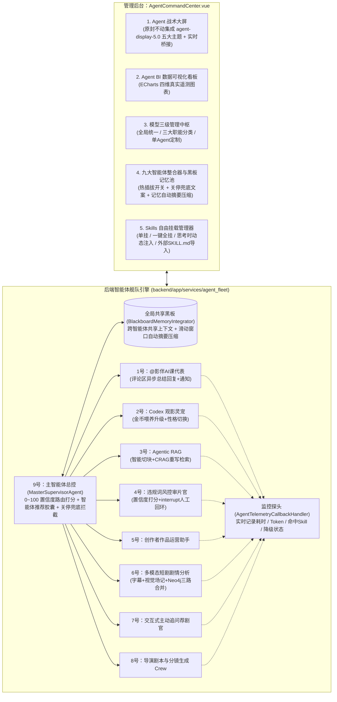

# CinemaAgent 九大智能体舰队、战术大屏与无限画布 —— 两阶段全景实施计划书

> **文档定位**：本计划书作为项目长期持久化的“工程记忆锚点”，完整记录用户提出的全部核心需求、第一阶段（智能体舰队 + 模型统一/分类治理 + Skills 挂载器 + 战术大屏与 BI 看板）与第二阶段（创作者无限画布双重保险 + Docker `ai-moive-studio` / `infinite-canvas` 融合）的技术规范与原子实施清单，防止因对话窗口变长而遗漏任何一项功能。

---

## 一、全局需求总览（防遗忘核对表）

### 1. 基础身份权限与工程韧性底座
- [ ] **单账号多身份动态入口**：审核员（`REVIEWER`）和创作者（`CREATOR`）均属于普通用户的扩展身份，无需单独开号；用户在个人中心申请对应身份获批后，顶栏（`GlobalHeader.vue`）动态浮现 **【创作者中心】** 或 **【审核员工作台】** 专属特权按钮。
- [ ] **三级防崩与降级兜底**：所有智能体具备超时控制、令牌桶限流、指数退避重试与断路器保护；遇到大模型超时或离线时，自动按“重试 -> 备用模型 -> 本地字幕/规则库静态卡片”三级降级，绝不崩溃。

### 2. 第一阶段核心攻坚（当前最高优先级：智能体舰队 + 模型治理 + Skills + 战术大屏）
- [ ] **智能体大模型“统一管理 + 分类管理 + 单智能体定制”三级体系**：
  1. **统一管理模式（`GLOBAL_UNIFIED`）**：一键让 1~9 号智能体共用管理员配置的全局默认大模型，改一处全员生效；
  2. **职能分类管理模式（`CATEGORY_GROUP`）**：按三大类别批量绑定不同能力的大模型与 `temperature`：
     - **【推理与中枢类】**（9号主控、3号 Agentic RAG、6号多模态剧情分析）
     - **【创意与编导类】**（5号创作辅助、8号导演剧本分镜、2号 Codex 灵宠）
     - **【高频快筛与社区类】**（1号评论区 `@AI` 课代表、4号违规词风控、7号交互荐剧）
  3. **单智能体独立定制（`AGENT_CUSTOM`）**：支持为任意单个智能体单独指定 Provider、Model、Base URL、API Key、Temperature 与流式开关。
- [ ] **全智能体热插拔与后台关停优雅兜底提示**：
  - 后台可随时一键开启/关闭 1~9 号任意智能体（`is_enabled`）；
  - 当某智能体被后台关停时，用户调用不会报错，而是触发管理员预设的**温和关停兜底提示（`disabled_fallback_msg`）**，并由 9 号主控自动降级代答。
- [ ] **Skills 自由挂载管理器（单挂 / 全挂 / 思考时按需调用 + 外部 GitHub Skills 导入）**：
  - 支持扫描项目 `.agents/skills` 与内置的 6 大短剧行业黄金 `SKILL.md`，并预留外部 GitHub `SKILL.md` 一键上传/在线编辑接口；
  - 支持勾选挂载到单个/多个指定智能体，或开启 **“一键全量挂载（`is_global_mount`）”** 共享给全部智能体；
  - 智能体在 `Thought` 思考阶段自动判定是否需要调用已挂载的 Skill，命中后动态注入完整 `SKILL.md` 正文指令。
- [ ] **九大垂直领域专家智能体 + 管理员整合器（Memory Integrator）**：
  - **1号 `@影伴AI课代表`（评论区托管 AI Bot）**：在评论区或弹幕被 `@` 时异步唤醒，自动总结该视频/分集核心剧情，以官方 Bot 账号在二级楼中楼回复并向用户小铃铛天窗发送“回复我的”通知；
  - **2号 `Codex 观影灵宠伴侣`**：个人中心专属宠物管理舱，支持领养改名、切换性格（毒舌影评喵/悬疑推理犬/甜宠磕糖兔，动态改变 `role+goal+backstory`）、消耗金币喂食升级、陪看互动；
  - **3号 `Agentic RAG 分片切块与自反思检索专家`**：智能选择字幕/剧本切块策略，在线检索具备 CRAG 相关性评估与 Query Rewrite 自动重写重搜；
  - **4号 `违规词评审风控 Agent`**：本地敏感词快筛 + AI 语义违规置信度打分（0~100）；对 `30~85` 分灰色地带弹幕/评论触发 LangGraph `interrupt` 挂起至审核员工作台，支持审核员通过 `Command(resume)` 批准放行或违规拦截；
  - **5号 `创作者中心作品辅助 Agent`**：生成爆款短剧标题、题材标签、吸睛简介与受众爽点分析；
  - **6号 `多模态短剧剧情深度分析 Agent`**：通过“字幕时间轴轨（耳朵）+ 关键帧视觉场记单（眼睛）+ Neo4j 人物关系图谱（大脑）”三路并行 Map-Reduce 合并推理，解决纯文本 Agent 无法识别视频画面内容的难题；
  - **7号 `交互式主动追问推荐 Agent`**：绑定 `@tool` 查询当前系统 MySQL 真实在架作品（杜绝幻觉瞎编），主动反问用户口味偏好后推荐真实短剧卡片；
  - **8号 `短剧导演与剧本分镜写作 Agent`**：采用 `Plan & Execute` + `编剧 -> 导演 -> 毒舌制片人审稿打回` 循环，结合挂载的短剧 Skills 输出结构化剧本、角色设定卡与分镜脚本表；
  - **9号 `主智能体总控台（Master Supervisor）` + `管理员整合器`**：通过 0~100 置信度打分自动调用 1~8 号子智能体，或弹出**“推荐智能体胶囊”**供用户选择；所有智能体共用 `Blackboard` 全局黑板上下文；管理员整合器统一管控会话记忆滑动窗口与自动摘要压缩（`Summarization`）。
- [ ] **`agent-display-5.0` 战术大屏原封不动集成 + Agent BI 数据可视化看板**：
  - 原封不动引入本地 `E:\浏览器下载内容\agent-display-5.0\index.html`（含 `01 OPS`、`02 SPIDER`、`03 NEURAL`、`04 FACTORY`、`05 NEBULA` 五款 2D/3D 主题），通过 `cinema_agent_bridge.js` 与系统内部 1~9 号智能体的真实派单、Token 消耗和质检数据实时兼容联动；
  - 配套 **ECharts Agent BI 数据可视化看板**（基于 `Callback` 真实遥测日志展示调用占比、Token 与耗时趋势、Skills 触发排行、关停兜底与降级统计）。

---

### 3. 第二阶段储备计划（待第一阶段智能体与战术大屏完善后实施：创作者无限画布双重保险）
> **重要备忘（防遗忘）**：在第一阶段全部交付验收后，立即衔接启动第二阶段 **【创作者中心无限画布（双重保险方案）】**！

- [ ] **第一重保险（内置原生轻量级短剧节点连线无限画布 —— 免 Docker 开箱即用）**：
  - 在 `CreatorStudioView.vue` 构建基于 Vue 3 缩放平移画布与 SVG 贝塞尔连线的节点工作台；
  - 与 5号/8号导演智能体联动，一键在画布上自动生成并连线：`【剧本大纲节点】 -> 【角色/场景外貌锁死设定卡节点】 -> 【第1~N镜分镜卡片节点】 -> 【毒舌制片人审稿节点】 -> 【画面/TTS配音预览节点】`。
- [ ] **第二重保险（外部 Docker 无限画布无缝内嵌 + OpenAI 协议桥接网关 —— 零代码臃肿）**：
  - 支持将 **`869413421/ai-moive-studio`（AICON 影视无限画布，首选）** 或 **`basketikun/infinite-canvas`（轻量通用无限画布，备选）** 部署在本地 Docker 容器中独立运行；
  - 前端提供 **【外部 Docker 画布引擎切换器】**（预设 `ai-moive-studio` 与 `infinite-canvas` 端口配置、在线探活检测、页内无边框沙箱嵌入与一键全屏唤醒，以及一键复制 Docker 启动命令指南）；
  - 后端提供 **`POST /api/v1/bridge/openai/v1/chat/completions`** 标准兼容网关，让外部 Docker 画布直接调用本系统的 9 号主控与 5/8 号导演智能体（含已挂载的 Skills），并支持剧本分镜 JSON 双向导入导出。

---

## 二、高内聚低耦合模块化拆分与防幻觉微创规范

针对当前项目中部分既有视图文件体积较大（如 `AdminView.vue` 已达 7,960 行、`PlayerView.vue` 已达 6,535 行、`UserProfileView.vue` 已达 3,481 行、`CreatorStudioView.vue` 已达 2,331 行），为实现**“用最少的对话轮次、零幻觉、零遗漏地交付高质量产品”**，本计划严格执行以下 **4 条高内聚低耦合架构铁律**：

### 1. 四条防幻觉与解耦铁律
1. **老文件“微创插槽挂载”原则（拒绝大文件内联堆砌）**：
   - 严禁往 `AdminView.vue`、`PlayerView.vue`、`UserProfileView.vue`、`CreatorStudioView.vue` 里直接塞入几百行新 HTML/JS；
   - 所有新增 UI 全部封装为独立高内聚的 `.vue` 子组件，原大文件**仅增加 5～15 行 `<Component />` 引用与 Tab 入口**，彻底杜绝修改大文件时发生上下文截断或破坏原有功能。
2. **单文件黄金体积红线（每个新模块 150～350 行）**：
   - 原本如果把 9 个智能体写在一个文件里会超过 1,500 行，容易触发大模型偷懒省略；现在我们将后端 `agent_fleet/` 拆分为 **1 个抽象契约基类 + 3 个基础底座模块 + 4 个领域专家工作组模块 + 1 个 9 号总控整合器**，每个文件严格控制在 **150～350 行**，每次生成一气呵成、100% 完整无占位符。
3. **统一热插拔契约（开闭原则 OCP）**：
   - 定义统一的 `BaseSpecialistAgent` 接口（统一输入 `AgentTaskRequest`、统一输出 `AgentTaskResponse`）；
   - 9 号主智能体总控台（`integrator.py`）通过注册表字典（`AGENT_REGISTRY`）动态调度 1~8 号智能体。未来新增第 10 号智能体或新增第 N 个 `SKILL.md` 时，只需往注册表挂载即可，无需改动核心调度代码。
4. **并行子智能体协同加速（最少对话轮次）**：
   - 由于后端 `agent_fleet` 模块与前端独立子组件之间通过清晰的 REST API 契约解耦，进入执行模式后可按模块边界高并发一次性落地，无需用户反复多轮催促。

### 2. 精细化模块划分与职责边界表（精确到每个文件怎么做）

| 模块分层 | 精确文件路径 | 高内聚单一职责说明 | 对外暴露接口 / 挂载方式 | 预估行数 |
| :--- | :--- | :--- | :--- | :--- |
| **数据模型层** | `backend/app/models/agent_hub.py` | 定义 7 张核心表：`AgentConfig`（含三级模型字段）、`AgentModelCategoryConfig`（三分类模型表）、`SkillConfig`、`AgentBlackboardSession`、`UserCompanionPet`、`ModerationInterruptQueue`、`AgentTelemetryLog` | SQLAlchemy ORM Models，由 `database.py` 启动自动建表与种子注入 | ~240 行 |
| **底座 1：统一契约与遥测** | `backend/app/services/agent_fleet/base_and_telemetry.py` | 定义 `BaseSpecialistAgent` 抽象接口、三级模型动态解析器（`resolve_agent_model`：全局统一 / 三分类 / 单智能体定制）、以及 `AgentTelemetryCallbackHandler` 真实耗时与 Token 探头 | `resolve_agent_model(db, agent_id)`、`record_telemetry(...)` | ~220 行 |
| **底座 2：Skills 挂载器** | `backend/app/services/agent_fleet/skill_registry.py` | 扫描 `.agents/skills` 并种子化 6 大短剧行业黄金 `SKILL.md`；支持单挂、多挂与 `is_global_mount` 一键全挂；在 `Thought` 阶段按关键词/语义自动注入命中的 `SKILL.md` SOP | `match_and_inject_skills(db, agent_id, query)` | ~240 行 |
| **底座 3：黑板与记忆整合器** | `backend/app/services/agent_fleet/blackboard_memory.py` | 维护跨智能体共享的 `Blackboard`（剧情锚点、用户偏好、角色设定）；当会话超过 6 轮时自动触发 `Summarization` 滑动窗口摘要压缩 | `get_shared_context(...)`、`append_and_compress(...)` | ~200 行 |
| **专家组 A（社区与养成）** | `backend/app/services/agent_fleet/workers_community.py` | **1号 `@影伴AI课代表`**：被 `@` 时异步总结分集剧情、写二级楼中楼回复并推小铃铛通知； **2号 `Codex 观影灵宠`**：切换 3 种性格（改变 `role+goal+backstory`）、扣减真实金币喂食升级、陪看聊天 | `run_agent_1_comment_bot(...)`、`run_agent_2_codex_pet(...)` | ~280 行 |
| **专家组 B（检索与风控）** | `backend/app/services/agent_fleet/workers_rag_safety.py` | **3号 `Agentic RAG 专家`**：智能分片策略推荐 + CRAG 检索相关性自反思与重写； **4号 `违规词风控审片官`**：敏感词快筛 + 0~100 风险打分 + `30~85` 分触发 `interrupt` 挂起待审与 `Command(resume)` 恢复 | `run_agent_3_agentic_rag(...)`、`run_agent_4_safety_guard(...)` | ~280 行 |
| **专家组 C（剧情与荐剧）** | `backend/app/services/agent_fleet/workers_cinema.py` | **6号 `多模态短剧剧情深度分析`**：字幕时间轴（耳）+ 关键帧视觉场记（眼）+ Neo4j 人物关系（脑）三路 Map-Reduce 合成； **7号 `交互式主动追问推荐`**：绑定 `@tool` 查真实 MySQL `videos` 表防幻觉 + 主动追问口味 | `run_agent_6_multimodal_plot(...)`、`run_agent_7_recommender(...)` | ~300 行 |
| **专家组 D（创作与导演）** | `backend/app/services/agent_fleet/workers_creator.py` | **5号 `创作者爆款运营助手`**：爆款剧名、黄金前3秒钩子、受众爽点生成； **8号 `导演剧本与分镜写作 Crew`**：`Plan & Execute` + `编剧 -> 导演 -> 毒舌制片人审校` 循环输出剧本与分镜表 | `run_agent_5_creator_assist(...)`、`run_agent_8_director_crew(...)` | ~300 行 |
| **中枢：9号总控与整合器** | `backend/app/services/agent_fleet/master_integrator.py` | **9号 `主智能体总控台`**：统一拦截 `is_enabled` 热插拔开关（关闭时返回 `disabled_fallback_msg` 并优雅代答）、0~100 置信度路由打分、生成推荐智能体胶囊、统一串联底座 1/2/3 与专家组 A/B/C/D | `MasterIntegrator.dispatch(...)` | ~260 行 |
| **API 路由网关** | `backend/app/api/v1/endpoints/agent_hub.py` | 暴露九大智能体对话、三级模型管理、热插拔开关、Skills 挂载、灵宠喂养、风控回环审批、黑板压缩与战术大屏遥测接口 | 挂载至 `/api/v1/agent-hub/*` | ~340 行 |
| **战术大屏非侵入桥接** | `frontend/public/agent-display-5.0/cinema_agent_bridge.js` | 原封不动保留 `agent-display-5.0/index.html`（含 5 套 2D/3D 主题），通过独立桥接脚本轮询 `/api/v1/agent-hub/telemetry/live` 实时同步 1~9 号智能体真实数据 | 注入 `index.html` 底部单行 `<script>` | ~180 行 |
| **前端插件 1：管理中台指挥舱** | `frontend/src/components/AgentCommandCenter.vue` | 封装【战术大屏全屏/内嵌容器】【ECharts Agent BI 四维看板】【三级模型统一/分类/定制管理台】【九大智能体热插拔与记忆整合器】【Skills 自由挂载管理器】【4号风控人工回环审批台】 | 在 `AdminView.vue` 中仅用 `<AgentCommandCenter :subTab="..." />` 10 行代码微创挂载 | ~420 行 |
| **前端插件 2：灵宠与多智能体坞** | `frontend/src/components/CodexPetWidget.vue` | 封装【个人中心 2号 Codex 灵宠养成舱】、【播放器 9号主控推荐胶囊 + 6号多模态剧情 + 7号追问荐剧协同面板】、【创作者 5号/8号导演分镜工坊】 | 在 `UserProfileView`、`PlayerView`、`CreatorStudioView` 微创挂载 | ~380 行 |

---

## 三、第一阶段架构图解

---

## 三、第一阶段 12 步原子实施清单

1. **步骤 1（数据模型层）**：创建 `backend/app/models/agent_hub.py`，定义 `AgentConfig`（含 `model_category` 与 `model_bind_mode` 三级模型字段）、`AgentModelCategoryConfig`（三大职能分类模型表）、`SkillConfig`、`AgentBlackboardSession`、`UserCompanionPet`、`ModerationInterruptQueue` 与 `AgentTelemetryLog`。
2. **步骤 2（数据库与种子初始化）**：修改 `backend/app/core/database.py`，注册新增表并编写自动种子逻辑：创建 `@影伴AI课代表` 官方 Bot 账号、初始化 1~9 号智能体配置、初始化三大模型分类（推理与中枢类 / 创意与编导类 / 高频快筛与社区类）、扫描 `.agents/skills` 并注入 6 个短剧行业黄金 `SKILL.md` 技能插件。
3. **步骤 3（Callback 遥测探头）**：创建 `backend/app/services/agent_fleet/telemetry_callback.py`，实现 `AgentTelemetryCallbackHandler`，真实记录每次调用的智能体、实际解析的模型名、命中的 Skill、耗时、Token 与状态。
4. **步骤 4（Skills 自由挂载管理器）**：创建 `backend/app/services/agent_fleet/skill_registry.py`，支持扫描本地 `SKILL.md`、在线增删改 Skill、指定 Agent 挂载、一键全量挂载、以及在 `Thought` 思考阶段动态注入命中的 Skill SOP。
5. **步骤 5（黑板共享记忆与自动压缩整合器）**：创建 `backend/app/services/agent_fleet/blackboard_memory.py`，实现 `BlackboardMemoryIntegrator` 全局黑板读写与超出窗口自动摘要压缩（`Summarization`）。
6. **步骤 6（九大智能体与三级模型路由核心引擎）**：创建 `backend/app/services/agent_fleet/nine_agents_engine.py`，实现三级模型解析器（全局统一 / 分类管理 / 单 Agent 定制）及 1~9 号智能体完整业务逻辑（含后台关停优雅兜底提示与三级防熔断降级）。
7. **步骤 7（后端 API 路由网关）**：创建 `backend/app/api/v1/endpoints/agent_hub.py` 并挂载至 `router.py`，暴露九大智能体对话调度、模型统一/分类/定制管理、热插拔开关、Skills 挂载管理、灵宠金币喂养、风控回环审批、记忆压缩与实时遥测 BI 接口。
8. **步骤 8（评论区 `@AI` 课代表与弹幕风控联动）**：修改 `backend/app/api/v1/endpoints/interactions.py` 与 `danmaku.py`，接入 4 号风控智能体实时审查与 1 号 `@影伴AI课代表` 异步自动总结回复及小铃铛通知推送。
9. **步骤 9（`agent-display-5.0` 原封不动集成与实时桥接）**：将本地 `E:\浏览器下载内容\agent-display-5.0\index.html` 集成至 `frontend/public/agent-display-5.0/index.html`（及后端静态目录），编写并注入 `cinema_agent_bridge.js`，使 5 款主题实时同步本系统 1~9 号智能体的真实数据。
10. **步骤 10（管理后台智能体指挥中心与 BI 看板）**：创建 `frontend/src/components/AgentCommandCenter.vue` 并集成至 `AdminView.vue`，实现【Agent 战术大屏】【ECharts Agent BI 数据可视化看板】【大模型统一与三分类管理面板】【九大智能体热插拔与黑板记忆整合器】【Skills 自由挂载管理器】与【4号风控人机回环审批台】。
11. **步骤 11（用户端/播放器/创作者端与动态身份顶栏）**：创建 `frontend/src/components/CodexPetWidget.vue` 并集成至 `UserProfileView.vue`、`PlayerView.vue`、`CreatorStudioView.vue` 与 `GlobalHeader.vue`，完成单账号获批后动态浮现特权按钮、2号 Codex 灵宠养成舱、评论区一键 `@影伴AI课代表`、播放器 9号主控/6号剧情/7号荐剧协同面板、以及创作者中心 5号/8号导演剧本分镜工坊。
12. **步骤 12（端到端闭环验证测试）**：编写并运行 `tests/verify_nine_agents_and_tactical_display.py`，对全部 12 项核心能力进行自动化闭环测试并保存实测截图。
