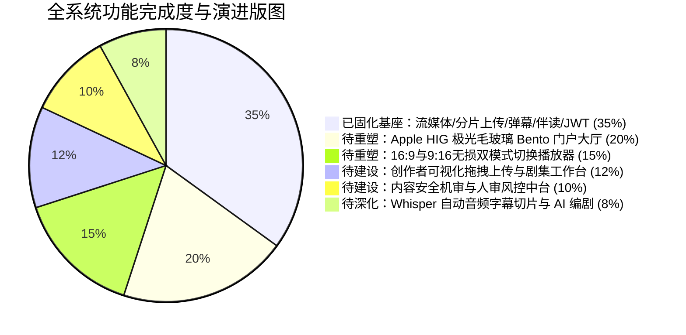
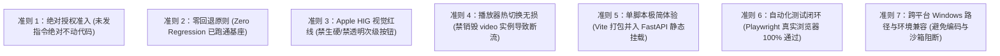

# 🎬 CinemaAgent 全系统未完成功能盘点、Apple HIG Bento 重塑规范与执行严苛准则书

> **文档定位**：全量功能差距分析（Gap Analysis）、前端极致重塑标准（Apple HIG / Bento Grid / 双模式播放器）、全栈待建功能规范、以及每次代码执行时必须死守的“严苛铁律与注意事项”。  
> **文档状态**：待用户严格审查（Strict Review Pending）  
> **执行准则承诺**：**在用户未明确发出“进入执行模式”指令前，绝对禁止改动任何项目业务代码！**

---

## 一、 用户痛点剖析与现状严正复盘

### 1.1 现状与用户预期差距诊断
- **痛点一：界面粗糙，缺乏现代设计美学**
  - **图一（当前现状）**：信息层级平铺直叙，色彩对比突兀，元素缺乏统一的网格韵律，边框与背景质感生硬，未脱离传统“粗糙后台/普通 Demo”的观感。
  - **图二（预期目标）**：采用 **Apple Human Interface Guidelines (HIG)** 与 **Bento Grid (便当盒美学)**。大面积极光渐变弥散背景、高质感毛玻璃（Glassmorphism）、微曲率大圆角（Squircle 24px）、物理级弹簧微动效、克制且高级的纯色胶囊按钮及大字阶排版，呈现宛如 Apple 官方发布会与原生 iOS/macOS 级别的顶级视觉体验。
- **痛点二：播放模式割裂，缺少横竖屏自由加载机制**
  - 传统短剧天然适合 **9:16 沉浸式移动端胶囊竖屏**，而高质量大片/长剧或宽屏设备用户强烈依赖 **16:9 极简影院宽屏**。
  - 目前缺乏在同一播放视窗内“无损热切换”横屏/竖屏的加载机制，切屏不能造成视频缓冲断流、播放进度丢失或 AI 伴读对话中断。
- **痛点三：历史残留干扰与未经许可擅自执行**
  - 根目录/后端存在早期电商 demo 残留（如 `backend/trademind.db`），必须彻底清理，保持纯粹的多媒体短剧+AI 架构。
  - **核心戒律违背**：此前多次在计划制定完毕后未经用户最终确认便自动进入执行模式，严重剥夺了用户的审查把控权。本执行书立下不可逾越之红线：**必须用户显式发出指令方可推进！**

---

## 二、 全系统现状全景盘点：已完成基座 vs 待做/未完善清单

### 2.1 【已完成并固化的底层基座】（严禁破坏、保持零回退）
以下模块已完成代码落地并通过真实浏览器无头自动化测试（Playwright E2E）：
1. **中国联通沃盘直连流式点播网关** (`backend/app/api/stream.py`)
   - 突破网盘下载限速与防盗链，支持 HTTP 206 Partial Content 分段流式转发与毫秒级 Seek。
2. **大文件切片上传与 FFmpeg 首帧抽取** (`backend/app/api/upload.py`)
   - 3 阶段切片上传协议（Init -> Chunk -> Complete），自动生成封面图并回传沃盘。
3. **分集弹幕与 DFA 敏感词毫秒级机审** (`backend/app/api/danmaku.py`)
   - WebSocket 分集房间多轨实时广播，敏感词自动拦截并录入机审待办。
4. **时间轴 RAG 剧情伴读 Agent** (`backend/app/api/agent.py`)
   - 视频知识结构化切片入库，剧情答疑、时间戳跳转按钮与播放器帧级联动。
5. **JWT + bcrypt 多角色权限中枢** (`backend/app/api/auth.py`)
   - 游客免登录看剧，高阶操作（点赞/发弹幕/评论）触发无感鉴权弹窗，支持 USER / CREATOR / REVIEWER / ADMIN。

---

### 2.2 【待做与未完善的核心功能深度清单】（按模块严谨展开）

#### 模块 A：前端 UI/UX 革命性重塑 —— Apple 质感 Bento Grid 门户大厅
*当前状态：原页面布局拥挤、色彩生硬，急需全面重构。*
- **A1. 极光与毛玻璃环境基座 (Aurora & Glass Base)**
  - **画布底色**：统一采用 Apple 标志性冷灰白 `#F5F5F7`；
  - **极光弥散球 (Ambient Orbs)**：背景层固定（`fixed`）2~3 个巨大光球（50vw~60vw），淡蓝 `rgba(162, 210, 255, 0.4)` 与淡紫 `rgba(200, 180, 255, 0.3)`，叠加 `filter: blur(80px)`，配合 12s~16s 无限呼吸浮动动画；
  - **毛玻璃材质**：卡片与导航栏统一采用 `rgba(255, 255, 255, 0.8)`，结合 `backdrop-filter: blur(20px)` 与 1px 半透明发丝高光边框（`rgba(255, 255, 255, 0.6)`）；
- **A2. Bento Grid (便当盒) 模块化展架**
  - **主体容器限制**：大屏严格居中（`max-width: 1120px`），卡片间距统一宽敞的 `24px~32px`，杜绝一切拥挤局促；
  - **主推短剧 Feature Bento (2x2 大卡)**：大图沉浸质感、微缩渐变角标、动态播放量胶囊；
  - **分类快捷 Bento**：都市战神、悬疑逆袭、现代甜宠等分类采用拟态 Squircle 图标与微渐变容器；
  - **热门排行 Bento 列表**：Top 10 榜单采用精致排版与金银铜质感徽章；
- **A3. 按钮与交互规范 (Button & Input Hierarchy)**
  - **Primary 核心行动按钮**：纯正 Apple 蓝实心填充 (`#0071e3`) + 纯白文字 + 胶囊大圆角（Pill），Hover 时带微光晕与 `scale(1.02)` 物理弹簧缩放；
  - **Secondary 次级按钮**：**绝对禁止透明线框**！必须使用浅灰实心填充 (`#E5E5EA`) + 深色文字，在白色毛玻璃卡片上保证高对比度；
  - **输入框 Inputs**：无边框浅灰底 (`#F2F2F7`)，Focus 时背景变为纯白并伴随 `#0071e3` 柔和聚焦光晕；
  - **字体与排版**：采用 `-apple-system, "SF Pro Display", "PingFang SC"` 字体栈，大标题粗黑 (700, 字间距 `-0.02em`)，辅助注释优雅灰 (`#86868b`)。

#### 模块 B：双模式智能影院播放器 (Landscape & Portrait Dual-Mode Player)
*当前状态：仅具备单一的黑底框架，缺乏横竖屏智能加载与自由切换机制。*
- **B1. 顶部一键切换模式控制台**
  - 在播放器顶部或控制栏提供醒目的双模态切换胶囊：**【🖥️ 16:9 极简宽屏影院】** vs **【📱 9:16 沉浸短剧胶囊】**；
  - **核心技术要求（无损热切换）**：切换模式时，**绝不销毁或重建 `<video>` 实例**，仅通过响应式容器的 CSS 动画及布局形态平滑 morphing（变形过度），视频播放进度（currentTime）、缓冲进度、静音/音量状态、弹幕轨道状态 100% 保持无缝连续！
- **B2. 16:9 极简宽屏影院模式 (Cinema Landscape Mode)**
  - 适合横版大片或大屏桌面观影，视频主体占居左 70% 宽幅，采用 16:9 黄金观影比例，四周带有微弱的环境光晕（Ambilight）；
  - 右侧 30% 为毛玻璃卡片式“剧情伴读 Agent 对话区”与“剧集列表”，下部为宽幅弹幕输入栏。
- **B3. 9:16 沉浸短剧胶囊模式 (Mobile Capsule Portrait Mode)**
  - 适合经典竖屏微短剧，视频呈现为居中 9:16 拟态 iPhone/手机形态，带有 24px Squircle 连续大圆角与外发光阴影；
  - AI 伴读抽屉可从底部或侧边优雅浮现（Slide-over Drawer），点赞/收藏/评论浮动在视频右侧竖向布局。

#### 模块 C：创作者可视化工作台 (Creator Studio UI & Workflow)
*当前状态：目前仅能通过脚本模拟上传，创作者端完全缺乏前端交互界面。*
- **C1. 可视化大文件分片断点上传组件**
  - 支持将 GB 级超大短剧视频直接拖拽到毛玻璃虚线卡片中；
  - 前端利用 Web Worker 自动切片（默认 5MB/片），展示精致 Apple 风格进度条、上传速率（MB/s）、剩余预估时间；
  - 支持暂停、断点恢复以及网络异常自动 3 次幂律重试；
  - 上传完成后，实时展示 FFmpeg 首帧抽取、转码队列、沃盘远端同步状态看板。
- **C2. 短剧剧集与分集编排面板**
  - 新建剧集专辑（剧名、分类、简介、16:9/9:16 封面拖拽上传）；
  - 分集卡片拖拽重排（第 1 集、第 2 集顺序调整）、单集标题/高能看点设置、试看权限切换。

#### 模块 D：内容安全风控与人审控制台 (Content Moderation & Review Studio)
*当前状态：底层 DFA 机审已拦截违规数据写入数据库，但无前端可视化裁决面板。*
- **D1. 机审违规弹幕待审列表**
  - 呈现所有触发 DFA 敏感词的发言：触发时间、用户 ID/昵称、关联剧集、命中违禁词高亮标红、完整发言；
  - 审核员操作：【误杀放行】（一键重新激活并展示到前台）、【确认违规】（归档违规记录）、【封禁用户】（将恶意账号修改为 BANNED 封禁态）。
- **D2. 创作者新剧提审与终审大厅**
  - 创作者上传的新剧进入待审队列，审核员可在线调取沃盘流媒体快速抽检预览，并给出“通过上架”或“填写驳回整改意见”。

#### 模块 E：深度多模态 Agent 矩阵 (Multimodal AI Pipeline)
*当前状态：目前为预置时间轴剧情知识库，缺乏新上传视频的自动语音转写与 AI 编剧工具。*
- **E1. Whisper 音频自动转写与时间轴切片流水线**
  - 视频上传转码就绪后，可选触发后台轻量语音识别提取音轨，生成带有精确秒数（如 `00:15 - 00:32`）的逐句字幕文本；
  - 自动化清洗并切片存入 `video_knowledge_chunks` 数据库，实现**“新传任何视频，AI 伴读秒级自动学习并可问答”**。
- **E2. 创作者 AI 编剧看点助手**
  - 创作者在工作台一键点击“提炼本集看点”，Agent 读取字幕切片，自动总结输出“本集逆袭爽点”、“反转镜头秒数”、“推荐爆款标题”。

#### 模块 F：用户个人中心与播放生态闭环 (User Profile & History)
*当前状态：底层有历史表，但缺少独立管理界面。*
- **F1. 跨端播放历史漫游面板**
  - 记录用户看过的每一部短剧最后停留的集数与秒数，点击卡片直接“断点续播”跳转；支持一键清空历史记录。
- **F2. 我的收藏与点赞追剧列表**
  - 统一查看个人收藏的短剧专辑，有新集更新时呈现红点提示。

#### 模块 G：代码库卫生与旧 Demo 残留彻底剔除 (Code Cleanliness)
*当前状态：存在早期电商 demo 的残留文件。*
- **G1. 剔除无用数据库与冗余文件**
  - 删除 `backend/trademind.db`（早期电商残留 SQLite 库）；
  - 全局检索并剔除任何与多媒体视听/Agent 平台无关的死代码或过期引用。

---

## 三、 每次执行必须遵守的“严苛铁律与注意事项” (Execution Guardrails)

在后续每一次进入执行阶段时，必须强制遵守以下 **7 大生命线准则**：

### 3.1 准则一：绝对授权准入铁律（Explicit Permission Only）
- **红线**：严禁在输出方案、计划或分析后，自动或默认切换到 `[MODE: EXECUTE]`；
- **操作规范**：
  - 凡是未收到用户明确含有类似“**进入执行模式**”或“**开始执行第 X 步**”的文字指令，必须始终停留在 `[MODE: PLAN]` 或 `[MODE: RESEARCH]`；
  - 每次计划完成后，只展示技术规范、影响分析与编号清单，把控制权 100% 归还给用户。

### 3.2 准则二：零回退原则（Zero Regression Guarantee）
- **红线**：绝不能为了美化前端而破坏已经调通的后端沃盘代理、大文件切片上传、WebSocket 弹幕流和伴读 Agent。
- **操作规范**：
  - 在重构前端 `HomeView.vue`、`PlayerView.vue`、`GlobalHeader.vue` 时，底层的 API client (`/api/v1/stream/...`, `/api/v1/danmaku/...`, `/api/v1/agent/...`, `/api/v1/auth/...`) 调用传参与返回解析必须严格保持契约一致；
  - 修改后必须同时执行 `test_step1` 到 `test_step7` 全套测试验证，确保旧功能无一受损。

### 3.3 准则三：Apple HIG 视觉规范硬指标（Visual Standards）
- **红线**：严禁出现粗糙毛糙的边框、拥挤的间距、刺眼的对比色或生硬的过渡。
- **设计检查清单（每次修改前端必查）**：
  - [ ] 画布是否为 `#F5F5F7`？是否包含淡蓝/淡紫双极光固定光球 (`blur(80px)`)？
  - [ ] 卡片容器是否具备 `backdrop-filter: blur(20px)` + `rgba(255,255,255,0.8)`？
  - [ ] 卡片圆角是否为 Apple 标准连续曲率大圆角（`border-radius: 24px`）？
  - [ ] 主按钮是否为纯正 Apple 蓝 (`#0071e3`) 胶囊？**次级按钮是否坚决使用了浅灰实心填充 (`#E5E5EA`) 而非透明幽灵按钮**？
  - [ ] 输入框是否为 `#F2F2F7` 无默认黑边并在 Focus 时有柔和光晕？
  - [ ] 间距是否保持在宽敞的 `24px` 以上，大屏最大宽度是否限制在 `1120px` 居中？
  - [ ] 动效曲线是否统一为物理弹簧 `cubic-bezier(0.25, 1, 0.5, 1)`，Hover 是否有微缩放 `scale(1.02)`？

### 3.4 准则四：双模式播放器无损切模（Seamless Dual-Mode Switching）
- **红线**：横屏切竖屏、竖屏切横屏时，严禁出现白屏、重新加载视频、播放进度归零或弹幕断开。
- **操作规范**：
  - 核心 `<video>` 元素与 Hls.js/原生播放器实例必须在整个组件生命周期内保持单例常驻；
  - 切换横屏/竖屏仅改变外层容器 CSS 类名与宽高比例尺寸（`transition: all 0.4s cubic-bezier(0.25, 1, 0.5, 1)`），内部视频通过 `object-fit: contain` / `cover` 动态自适应；
  - 伴读 Agent 对话抽屉在横屏模式下为右侧并列卡片，在竖屏模式下自动平滑变形为底部上滑抽屉。

### 3.5 准则五：单脚本极简启动体验保持（One-Click Start Experience）
- **红线**：严禁要求用户手动开 3~4 个终端窗口分别跑前端、跑后端、跑网盘。
- **操作规范**：
  - 前端重构完成后，必须通过 `npm run build` 输出编译包至 `frontend/dist`，由 FastAPI 在 `backend/main.py` 中静态托管；
  - 维持全项目仅需双击一个 **`一键启动多媒体平台.bat`** 即可在浏览器自动打开完整系统（包括 OpenList 守护进程与 FastAPI 全栈服务）。

### 3.6 准则六：测试驱动与真实浏览器闭环（Playwright E2E Verification）
- **红线**：严禁仅凭“代码写完没报错”就宣称功能完成。
- **操作规范**：
  - 每一个新模块落地，必须编写对应的 Playwright E2E 自动化测试脚本（真实模拟点击、输入、切模、流媒体播放、截图断言）；
  - 测试通过率必须达到 100%，并在测试中截取高清效果图供用户直观检验。

### 3.7 准则七：Windows 环境与编码兼容性（Platform Guardrails）
- **红线**：防止 PowerShell 中文路径乱码与本地端口冲突。
- **操作规范**：
  - 遇到脚本执行，统一配置 UTF-8 编码；
  - 数据库操作使用 SQLAlchemy 参数化与迁移脚本，杜绝字符集崩溃。

---

## 四、 推荐的实施演进路线（分步规划与推荐优先级）

为了让系统能够由浅入深、每一步都直观可见且严格受控，我们推荐按以下顺序逐步推进：

| 实施阶段 | 阶段主题 | 核心攻坚内容 | 交付成果与验收标准 |
| :--- | :--- | :--- | :--- |
| **Stage 1 (当前最紧急)** | **前端极致美学重塑：Apple HIG Bento 大厅与双模式播放器** | 1. 彻底改造 `HomeView.vue`，实现极光背景、Squircle Bento Grid、大字阶排版、胶囊按钮体系 2. 彻底重构 `PlayerView.vue`，实现 16:9 极简影院与 9:16 沉浸短剧的**无损热切换** 3. 剔除 `backend/trademind.db` 旧残留文件 | 产出真实浏览器渲染截图，对比图一图二，达到 100% Apple 质感并跑通 Playwright E2E 视觉与功能测试 |
| **Stage 2** | **创作者可视化工作台 (Creator Studio)** | 1. 新建 `CreatorView.vue` 创作者中心 2. 大文件拖拽分片断点续传进度条组件 3. 剧集专辑与分集拖拽排序管理 4. 沃盘云同步状态看板 | 创作者登录后，前端拖拽 50MB+ 视频，分片进度条流畅到达 100%，并自动同步至沃盘云盘 |
| **Stage 3** | **内容安全机审中台与人审控制台 (Moderation)** | 1. 新建 `ReviewerView.vue` 审核后台 2. 机审违禁弹幕列表、高亮词呈现、一键解封或封号 3. 创作者新剧提审流与终审上架面板 | 审核员进入后台，可实时看到被 DFA 拦截的违规发言，点击处置后前台实时生效 |
| **Stage 4** | **深度多模态 Agent 自动化升级** | 1. 集成 Whisper 音频转写字幕流水线 2. 自动提取秒级字幕并切片存入知识库 3. 创作者一键 AI 提炼剧情爆点与爆款标题助手 | 新上传视频自动生成字幕时间轴，伴读 Agent 自动掌握剧情且无需人工录入台词 |
| **Stage 5** | **用户中心与播放生态完善** | 1. 个人中心页面（更换头像、昵称、追剧收藏夹） 2. 跨端播放历史漫游与一键断点续播 | 退出重进或换浏览器登录后，自动记忆上次播放进度秒数并弹出续播提示 |

---

## 五、 实施清单（Checklist）

以下为全量完善的第一阶段（**Stage 1：前端极致美学重塑与双模式播放器**）原子操作清单：

实施清单：
1. 清理环境残留：删除 `backend/trademind.db` 及任何无用的历史电商残留文件。
2. 重塑全局设计系统：在前端全局样式中引入 Apple HIG 设计变量（极光弥散渐变、`#F5F5F7` 画布色、毛玻璃 `blur(20px)`、`24px` Squircle 连续曲率、Apple 品牌蓝 `#0071e3` 与浅灰实心次级按钮 `#E5E5EA`）。
3. 全方位重构短剧大厅 `frontend/src/views/HomeView.vue`：
   - 移除原有生硬平铺布局；
   - 部署固定背景极光光球呼吸层；
   - 按照 Bento Grid 网格重构主推视频大卡（2x2 Bento）、分类快捷 Bento、热门短剧展架；
   - 应用 Apple 规范按钮与排版层次（标题粗黑、字间距微缩、物理弹簧 Hover 动效）。
4. 全方位重构播放器 `frontend/src/views/PlayerView.vue`：
   - 增加顶部“16:9 极简宽屏影院”与“9:16 沉浸短剧胶囊”无损热切换控制栏；
   - 确保模式切换时视频播放实例不销毁、进度不中断、弹幕不断连；
   - 重构右侧/底部剧情伴读 Agent 对话抽屉，使其具备 Apple 拟态卡片质感与时间戳发光跳转按钮。
5. 前端编译与生产集成：运行 `npm run build`，更新 `frontend/dist` 静态资源供 FastAPI 服务挂载。
6. 自动化端到端测试验证：编写并运行 `test_step8_apple_bento_dual_player.py`，使用 Playwright 真实浏览器对 Bento 布局、极光背景、横竖屏切换无损性进行自动化验证并生成测试截图。
7. 成果审查与交付：整理变更对比与视觉截图，提请用户人工验收。

---

> ⚠️ **严正声明**：当前流程严格保持在 **`[MODE: PLAN]`**。在您审查完本规划书并明确发出**“进入执行模式”**或相关推进指令之前，我绝不会对代码进行任何改动！请您对本方案与注意事项进行严格审查。
